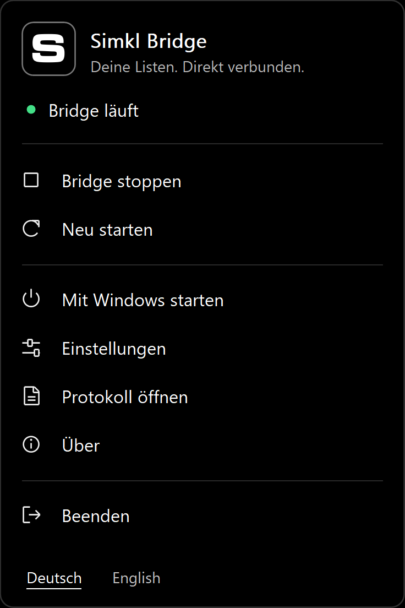

<p align="center">
  
</p>

<h1 align="center">Simkl Bridge für Windows</h1>

<p align="center">
  Importiere Simkl-Custom-Lists mit einer kompakten Windows-App in Sonarr und Radarr.<br>
  Docker, Python und Node werden nicht benötigt.
</p>

<p align="center">
  <a href="docs/installation.de.md"></a>
  <a href="https://github.com/Veyilla/simkl-bridge-windows/commits/main/"></a>
  <a href="LICENSE"></a>
</p>

<p align="center">
  <a href="README.md">English</a> · <strong>Deutsch</strong>
</p>

<p align="center">
  <a href="docs/installation.de.md">Installation</a> · <a href="docs/setup-simkl.de.md">Einrichtung</a> · <a href="docs/setup-simkl.de.md#fehlerbehebung">Fehlerbehebung</a>
</p>

## Was die App macht

- Stellt ausgewählte Simkl-Custom-Lists als lokale Importlisten für Sonarr und Radarr bereit.
- Bietet Start, Stop, Neustart, Windows-Autostart, Einstellungen und Protokoll in einem Menü neben der Uhr.
- Speichert Anmeldung und Listeneinstellungen. Es muss kein Konsolenfenster geöffnet bleiben.
- Bietet eine AMOLED-schwarze Oberfläche mit deutscher und englischer Beschriftung.

**Vorabversion:** Die grundlegende Einrichtung funktioniert; noch nicht jede Monitoranordnung und jeder Langzeitfall ist geprüft. Die Pakete sind derzeit nicht digital signiert.

## Voraussetzungen

- Windows x64; Sonarr und/oder Radarr laufen auf demselben Rechner.
- Ein Simkl-Konto mit **PRO oder VIP**, einschließlich kostenlosem Loyalty-PRO.
- Eine eigene Simkl-App-Registrierung mit **AUTH V2**. Ein Client Secret oder Administratorschlüssel von Sonarr/Radarr wird nicht benötigt.

**Kostenloses PRO:** Ein bezahltes Abo ist nicht erforderlich. Die [Einrichtungsanleitung](docs/setup-simkl.de.md#kostenloses-pro-ohne-bezahltes-abo) erklärt die benötigten Nutzungstage und die monatliche Freischaltung.

## Installation

In diesem Repository ist noch kein Release zum Herunterladen veröffentlicht. Wenn du bereits einen Vorabversions-Installer hast, folge der [Installationsanleitung](docs/installation.de.md). Andernfalls kannst du die App [selbst bauen](#selbst-bauen). Künftige Downloads findest du unter [Releases](https://github.com/Veyilla/simkl-bridge-windows/releases).

## Schnelle Einrichtung

Die App startet zunächst auf Deutsch. Du kannst die Sprache unten im Hauptmenü wechseln. Wenn gerade die Einstellungen geöffnet sind, gelangst du mit **Zurück** dorthin.

1. Öffne Simkl Bridge. Trage unter **Anmeldung** die Client-ID deiner AUTH-V2-App ein.
2. Wähle **Mit Simkl verbinden** und bestätige den angezeigten Code im Browser.
3. Lade unter **Listen** deine Listen oder füge einen Simkl-Listenlink ein. Ordne die Liste Sonarr oder Radarr zu.
4. Markiere die eingerichtete Liste, wähle **Adresse kopieren** und anschließend **Speichern und zurück**. Starte die Bridge, falls sie gestoppt ist.
5. Füge in Sonarr oder Radarr eine **Benutzerdefinierte Liste** mit der kopierten Adresse hinzu. Prüfe und speichere sie.

Wiederhole die Listenschritte für jedes Ziel. Registrierung, genaue Menüpfade und Erklärungen stehen in der [Schritt-für-Schritt-Anleitung](docs/setup-simkl.de.md).

## Im Alltag

Klicke mit der rechten Maustaste auf das S-Symbol neben der Windows-Uhr. **Bridge stoppen** beendet den Hintergrunddienst; das Symbol bleibt verfügbar. **Beenden** schließt die App und ihren Dienst. Mit **Mit Windows starten** aktivierst du den Autostart.

Statustext und Hinweis beim Darüberfahren erklären den Zustand: Grün bedeutet laufend, Gelb Start oder Neustart und Rot gestoppt oder Fehler. Unter **Über** öffnest du die Projektseite, die Lizenz und die Quellenhinweise.

<p>
  
</p>

*Menüvorschau; der gezeigte Verbindungsstatus ist ein Beispiel.*

## Listen aktualisieren und Daten schützen

Die Bridge prüft bei einem Listenabruf auf Änderungen und verwendet unveränderte Inhalte erneut. Sonarr und Radarr erhalten immer vollständige Listen. API-Fehler werden gemeldet und nicht als leere Listen ausgegeben. [So funktioniert die Aktualisierung](docs/refresh.de.md)

Nur eingerichtete Listen sind über `127.0.0.1` erreichbar. Einstellungen, Listencache und Protokoll liegen in `%LOCALAPPDATA%\SimklBridge`. Anmeldetokens werden mit dem Windows-Benutzerschutz DPAPI geschützt. Aktualisierungen und die normale Deinstallation erhalten diese Daten.

## Fehlerbehebung

Die [Hilfetabelle](docs/setup-simkl.de.md#fehlerbehebung) erklärt Anmeldefehler, leere Listen, PRO-Status und Portkonflikte. Weitere Angaben findest du unter **Protokoll öffnen**. Entferne Tokens und andere private Angaben, bevor du ein Problem meldest.

## Selbst bauen

Installiere unter Windows Go **1.26.1** und Inno Setup **7.1.1**. Führe anschließend im Repository-Ordner aus:

```powershell
./scripts/build.ps1 -ISCCExe 'C:/Pfad/zu/ISCC.exe' -ProjectURL 'https://github.com/Veyilla/simkl-bridge-windows'
```

Das Skript führt die Prüfungen aus und erstellt App, Installer, Windows-Archiv und Quellcodearchiv im benachbarten Ordner `Simkl-Bridge-Windows`. Der [GitHub-Workflow](.github/workflows/build.yml) kann von Personen mit Repository-Zugriff auch manuell gestartet werden. Er erstellt Artefakte und veröffentlicht kein Release. Eine zusätzliche Race-Prüfung benötigt unter Windows eine C-Werkzeugkette.

## Lizenz und Quellen

Copyright (c) 2026 **Veyilla Nightwhisper**. Veröffentlicht unter der [MIT-Lizenz](LICENSE).

Dies ist eine unabhängige App, kein offizielles Simkl-Produkt. Sie verwendet angepasste Resurrector-Bausteine, das Simkl-Bild aus Dashboard Icons und die Go-Windows-Bibliothek. Die ursprünglichen Hinweise und Lizenztexte stehen in den [Quellenhinweisen](THIRD_PARTY_NOTICES.de.md) und im [Lizenzordner](licenses).
