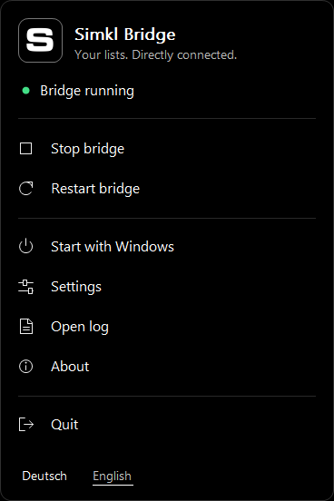

<p align="center">
  
</p>

# Simkl Bridge for Windows

Import Simkl Custom Lists into Sonarr and Radarr with a compact Windows tray app. No Docker, Python or Node runtime required.

[](docs/installation.en.md)
[](https://github.com/Veyilla/simkl-bridge-windows/commits/main/)
[](LICENSE)

**English** · [Deutsch](README.de.md)

[Installation](docs/installation.en.md) · [Setup guide](docs/setup-simkl.en.md) · [Troubleshooting](docs/setup-simkl.en.md#troubleshooting)

## What it does

- Makes selected Simkl Custom Lists available as local import lists for Sonarr and Radarr.
- Provides start, stop, restart, Windows startup, settings and logs from one tray menu.
- Keeps sign-in and list settings between sessions. No console window needs to stay open.
- Supports an AMOLED-black interface with German and English labels.

**Preview:** the core workflow is available, but not every monitor arrangement and long-term scenario has been verified. Builds are currently unsigned.

## Requirements

- Windows x64, with Sonarr and/or Radarr running on the same computer.
- A Simkl account with **PRO or VIP**, including free Loyalty PRO.
- A personal Simkl **AUTH V2** app registration. You do not need a client secret or Sonarr/Radarr administrator API keys.

**Free PRO:** a paid subscription is not required. The [setup guide](docs/setup-simkl.en.md#free-pro-without-a-paid-subscription) explains Simkl's activity requirement and monthly activation.

## Installation

No downloadable release has been published in this repository yet. If you already have a preview installer, follow the [installation guide](docs/installation.en.md). Otherwise, use the [build instructions](#building-from-source). Future downloads will be listed under [Releases](https://github.com/Veyilla/simkl-bridge-windows/releases).

## Quick setup

The app initially opens in German. If settings are shown, choose **Zurück**, then **English** at the bottom of the main menu. Reopen **Settings** to follow the English labels below.

1. Open Simkl Bridge. Under **Sign-in**, enter the Client ID of your AUTH V2 app.
2. Choose **Connect to Simkl** and approve the displayed code in your browser.
3. Under **Lists**, load your lists or paste a Simkl list link. Assign the list to Sonarr or Radarr.
4. Select the configured list, choose **Copy address**, then **Save and back**. Start the bridge if it is stopped.
5. In Sonarr or Radarr, add a **Custom List** import using the copied address, then test and save it.

Repeat the list steps for each destination. For registration, exact menu paths and explanations, see the [step-by-step setup guide](docs/setup-simkl.en.md).

## Everyday use

Right-click the S icon next to the Windows clock. **Stop bridge** stops the background service but keeps the tray icon available. **Quit** closes the app and its service. Enable **Start with Windows** for automatic startup.

The status text and hover tooltip explain the current state: green means running, amber means starting or restarting, and red means stopped or an error. **About** opens the project page, license and third-party notices.

<p>
  
</p>

*Menu preview; the connection status shown is an example.*

## Refreshing lists and protecting your data

The bridge checks for changes when a list is requested and reuses unchanged contents. Sonarr and Radarr always receive complete lists. API failures are reported instead of being returned as empty lists. [How refreshing works](docs/refresh.md)

Only configured lists are served on `127.0.0.1`. Settings, cached lists and logs stay in `%LOCALAPPDATA%\SimklBridge`. Sign-in tokens are protected with Windows DPAPI. Updates and standard uninstall preserve these data files.

## Troubleshooting

See the [troubleshooting table](docs/setup-simkl.en.md#troubleshooting) for sign-in errors, empty lists, PRO status and port conflicts. Choose **Open log** in the tray menu for details. If reporting a problem, remove tokens and other private information first.

## Building from source

On Windows, install Go **1.26.1** and Inno Setup **7.1.1**, then run from the repository folder:

```powershell
./scripts/build.ps1 -ISCCExe 'C:/Path/to/ISCC.exe' -ProjectURL 'https://github.com/Veyilla/simkl-bridge-windows'
```

The script runs the checks and creates the app, installer, Windows archive and source archive in the adjacent `Simkl-Bridge-Windows` folder. The [GitHub workflow](.github/workflows/build.yml) can also be run manually by someone with repository access; it creates artifacts without publishing a release. Race checking additionally requires a Windows C toolchain.

## License and credits

Copyright (c) 2026 **Veyilla Nightwhisper**. Licensed under the [MIT License](LICENSE).

This is an independent app, not an official Simkl product. It uses adapted Resurrector components, the Dashboard Icons Simkl image and the Go Windows library. Their original notices and license texts are included in [Third-party notices](THIRD_PARTY_NOTICES.md) and the [licenses folder](licenses).
